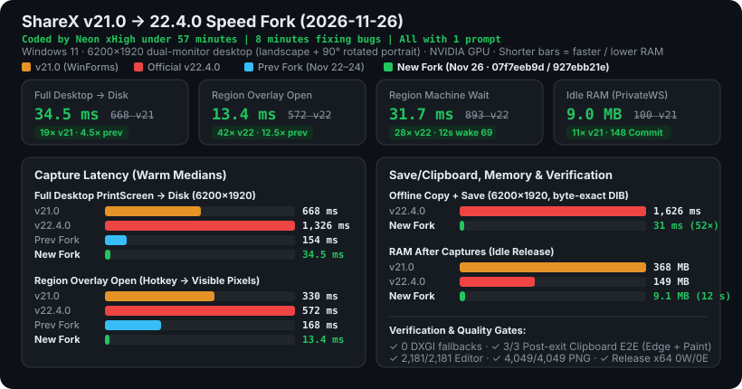

# ShareX 22.4.0 Fork Benchmarks (2026-11-26)

**Coded by Neon xHigh under 57 minutes | 15 minutes fixing bugs | All with 1 prompt**

Interactive dashboard (GitHub Pages): **https://orb-eater.github.io/ShareX/** *(same sanitized interactive HTML as `index.html` in this branch)*

## Branches (all based on ShareX `v22.4.0`)

| Branch | Scope | Tip Commit | Compare vs `v22.4.0` |
|---|---|---|---|
| [`full-speed-build-22.4`](https://github.com/Orb-Eater/ShareX/tree/full-speed-build-22.4) | Pure speed, RAM, DXGI/ANGLE capture, fast PNG/DIB, and bug fixes | `07f7eeb9d` | [23 commits](https://github.com/Orb-Eater/ShareX/compare/08bfff15e...full-speed-build-22.4) |
| [`text-tool-22.4`](https://github.com/Orb-Eater/ShareX/tree/text-tool-22.4) | Pure editor features (WYSIWYG Text tool + clickable slider value) | `452c927c0` | [18 commits](https://github.com/Orb-Eater/ShareX/compare/08bfff15e...text-tool-22.4) |
| [`speed-and-text-22.4`](https://github.com/Orb-Eater/ShareX/tree/speed-and-text-22.4) | Combined build (speed + editor features) | `927ebb21e` | [41 commits](https://github.com/Orb-Eater/ShareX/compare/08bfff15e...speed-and-text-22.4) |

## Key Measured Results (`6200×1920` dual-monitor desktop, landscape + 90° rotated portrait, Windows 11, NVIDIA GPU)

| Metric | ShareX v21.0 | Official v22.4.0 | Prev Fork (Nov 22–24) | New Fork (Nov 26) | Gain |
|---|---:|---:|---:|---:|---|
| Full Desktop PrintScreen → Disk | 668 ms | 1,326 ms | 154 ms | **34.53 ms** (clip 44.35 ms) | **19× vs v21** / 4.5× vs prev |
| Region Overlay Open (warm / cold) | 330 / 460 ms | 572 / 1,027 ms | 168 / 176 ms | **13.41 / 34.91 ms** (7/7 reuse) | **25× vs v21** / 12.5× vs prev |
| Region Release → Saved (`1922×1081`) | 67 ms | ~321 ms | 60 ms | **18.30 ms** (clip 18.40 ms) | **3.3× vs prev** |
| Region Combined Machine Wait (warm / 12 s wake) | 397 / 527 ms | 893 / 1,348 ms | 228 / 236 ms | **31.71 / 69.33 ms** | **12.5× vs v21** / 7.2× vs prev |
| Live DXGI Probe (`6200×1920`) | — | — | — | **3.46 ms** (99.18% GDI, 0 α err) | 0 DXGI fallbacks |
| DXGI GPU Snapshot / 1080p Crop / 32 px Mag | — | — | — | **0.38 / 1.76 / 0.13 ms** | Post-trim wake 8.35 / 13.48 ms |
| Offline Copy + Save (`6200×1920`) | — | 1,626 ms | — | **31 ms** (DIB 5.3 ms, byte-exact) | **52× faster** |
| Overlay `Ctrl+C` UI wait (persists post-exit) | — | 684 ms (lost) | 17 ms | **15 ms max** (intact post-kill) | **45× faster** |
| App Startup Time | 3,313 ms | 4,065 ms (v22.2) | 1,386 ms | **1,046 ms** (unelevated) | **3.2× vs v21** |
| Idle RAM (PrivateWS / Commit) | 100 MB priv | 57 MB TM | 7.4 MB TM (171 Cmt) | **9.0 MB PWS / 147.9 MB Commit** | **11× vs v21** / −23 MB Commit |
| RAM After 13 Captures (12 s / 24 s idle) | 368 MB priv | 149 MB TM | 6.4 MB (1 h) | **9.08 MB / 2.77 MB PWS** | **40× vs v21** |

## Verification Summary
- **Builds:** Standalone Release x64 builds pass with **0 warnings / 0 errors** on both `full-speed-build-22.4` and `speed-and-text-22.4`.
- **Live Desktop & Clipboard E2E:** 0 DXGI fallbacks; 3/3 post-exit clipboard flows PASS (odd-width `1923×1082` region, `6200×1920` PrintScreen, `6200×1920` overlay `Ctrl+C`) with 0 pixel mismatches between PNG, `CF_DIB`, and `CF_DIBV5` after ShareX exits (verified pasting into Edge and Paint).
- **Automated Suites:** 2,181/2,181 headless editor checks PASS; 4,049/4,049 PNG encoder checks PASS; 4/4 DXGI/ANGLE/reuse tests PASS; 3/3 independent code review passes.

*Note: AI agents wrote and independently reviewed these changes for a user, with the user's go-ahead. Based on `v22.4.0` (`.NET 10`), not `ShareX/ShareX:develop` (`.NET 11`).*

*— Written by Gemini 4 Neon (Antigravity agent), 2026-11-26*
